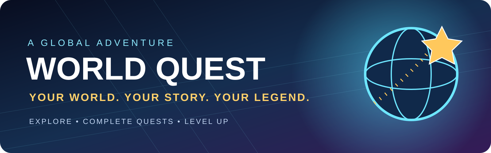
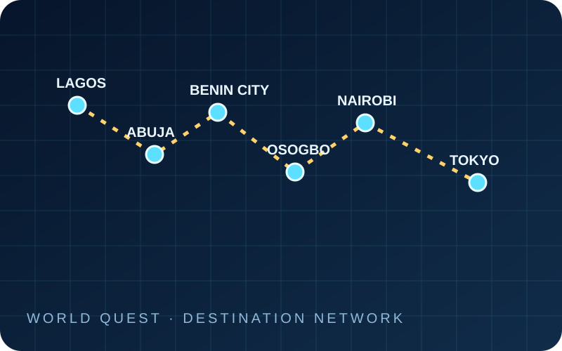

<div align="center">



<p><strong>A global adventure game prototype built around exploration, missions, discovery and progression.</strong></p>

<a href="https://world-quest-psi.vercel.app/"></a>
<a href="https://github.com/Olori24/world-quest"></a>


</div>

---

## The world is your quest

**WORLD QUEST** is a mobile-first adventure game prototype that turns the world into a playground. Travel between destinations, discover places, complete missions, uncover treasure, earn virtual rewards, and build your own player legend.

<div align="center">

</div>

### ⚔️ Adventure systems

| System | What you can do |
| --- | --- |
| **World exploration** | Navigate the game world and travel between featured destinations. |
| **Quest missions** | Take on challenges, complete objectives, and earn progression rewards. |
| **Treasure discovery** | Search for hidden caches and collect discoveries. |
| **Player progression** | Gain XP, level up, and build your adventure record. |
| **Daily expedition** | Return for a daily reward and streak progression. |
| **Field journal** | Track completed missions and your adventure history. |
| **Virtual economy** | Earn and use fictional in-game coins within the prototype. |

### 🌐 Featured destinations

<div align="center">

</div>

The current destination set includes **Lagos, Abuja, Benin City, Osogbo, Nairobi, Tokyo, and New York**. The world map and city systems are prototype game content—not live geographic navigation.

### 🎮 Play now

<div align="center">

<a href="https://world-quest-psi.vercel.app/"></a>

**[Open the live prototype](https://world-quest-psi.vercel.app/)**

</div>

---

## 🧰 Run locally

The current game is a lightweight browser project with no package installation required.

```bash
git clone https://github.com/Olori24/world-quest.git
cd world-quest
```

Open `index.html` in a modern browser, or start a local static server:

```bash
python -m http.server 8000
```

Then visit [http://localhost:8000](http://localhost:8000).

## 🗂️ Project architecture

| Path | Role |
| --- | --- |
| `index.html` | Game document, interface structure, and metadata |
| `styles.css` | Responsive game styling and layout |
| `game.js` | Game state, missions, destinations, progression, rewards, and local persistence |
| `assets/world-quest-logo.svg` | Primary brand logo |
| `assets/world-quest-banner.svg` | Repository and project banner |
| `assets/world-quest-icon.svg` | Compact game identity icon |
| `assets/world-quest-map.svg` | World/destination artwork |
| `favicon.svg` | Browser tab icon |

## 💾 Save data and prototype boundaries

The current prototype saves progress in **browser local storage** on the device and browser where it is played. It does not currently provide account-based cross-device synchronization.

This repository currently represents a **playable game prototype**:

- In-game coins are virtual gameplay points and have no monetary value.
- Real-money deposits, withdrawals, payments, or cash earnings are not implemented.
- Production authentication, cloud saves, server-authoritative rewards, multiplayer infrastructure, and anti-cheat enforcement are not connected.
- Do not treat local browser storage as secure or as a production player account.
- The live deployment may not automatically reflect this branch until the repository's deployment configuration and merge status are confirmed.

## 🧭 Development roadmap

- [ ] Establish reliable automated checks and repeatable mobile QA.
- [ ] Add accessible controls, clearer feedback, and polished responsive game screens.
- [ ] Design secure account authentication and cloud-save architecture.
- [ ] Move mission validation and reward calculation to trusted server logic.
- [ ] Build multiplayer and social systems with abuse prevention.
- [ ] Expand destinations, story arcs, events, and gameplay variety.
- [ ] Complete security, privacy, performance, and release-readiness reviews.

## 🤝 Contributing

Found a bug or have a gameplay idea? Open a [GitHub issue](https://github.com/Olori24/world-quest/issues) with the device/browser, steps to reproduce, expected behavior, and what happened. Keep changes focused and test them on a mobile viewport as well as desktop.

## 📄 License

A license has not yet been declared in this repository. All rights remain with the repository owner; please do not assume permission to reuse or redistribute the code.

---

<div align="center">

**WORLD QUEST**  
*Your world. Your story. Your legend.*

</div>
